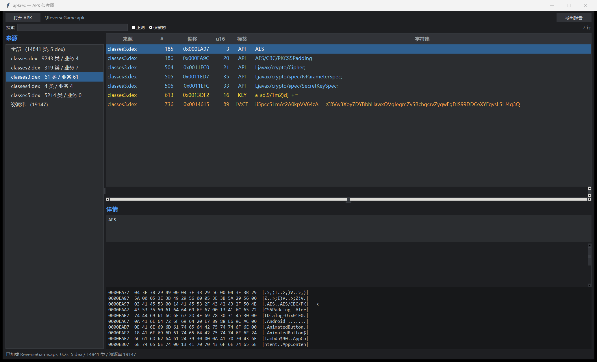

# apkrec

APK 逆向快速侦察器：一条命令回答「该看哪个 dex、哪条字符串在什么偏移、哪里像密钥/密文」。

只依赖 Python 3 标准库（GUI 用 Tkinter），Windows / macOS / Linux 通用。



## 它解决什么

反编译一个 APK 时，90% 的时间花在「找该看哪儿」：多个 dex 里哪个是业务代码、字符串池里哪几条像密钥、密文长什么样。apkrec 把这些压成一次操作：

```
$ python apkrec.py app.apk

dex               总类数     业务类      占比   判定
classes.dex      9243       4      0%   lib
classes2.dex      319       7      2%
classes3.dex       61      61    100%   ← 业务代码
classes4.dex        4       4    100%   (小模块)
classes5.dex     5214       0      0%   lib

业务包  com.example.reversegame   (61 个类, classes3.dex)

敏感字符串
  [HIGH    ] base64:base64  ×1
      classes3.dex  #736  0x0014615  ii5pccS1mAt2A0kpVV64zA==:C8Vw3Xoy...
  [MEDIUM  ] 16 字符 key   ×1
      classes3.dex  #613  0x0013DF2  a_sd.9/1m2)d]_+=
  [INFO    ] crypto API   ×7
      classes3.dex  #185  0x000EA97  AES
```

## 可执行文件（Windows）

不想装 Python 的话，直接从 [Releases](https://github.com/Sayb1e/apkrec/releases) 下载：

| 文件 | 大小 | 说明 |
|---|---:|---|
| `apkrec.exe` | 7.9 MB | 命令行版，双击会弹控制台；`apkrec.exe app.apk` |
| `apkrec-gui.exe` | 10.9 MB | 图形版，双击即开（无控制台窗口） |

两者都是 **PyInstaller onefile**，自包含 Python 3.12 + Tk，不需要目标机装任何东西。

自己打包：

```powershell
powershell -ExecutionPolicy Bypass -File .\build.ps1
```

## 用法

### CLI

```bash
python apkrec.py app.apk                        # 概览（默认）
python apkrec.py app.apk --json                 # 机器可读
python apkrec.py app.apk strings "flag|key"     # 字符串池过滤
python apkrec.py app.apk strings -d classes3.dex -u -m 200
python apkrec.py app.apk find "a_sd"            # dex + 资源一起搜
python apkrec.py app.apk hex classes3.dex 0x14615 -c 128
python apkrec.py app.apk report -o report.md    # Markdown 报告
```

| 子命令 | 说明 |
|---|---|
| `overview` | dex 分布、业务包、敏感字符串、建议命令（默认） |
| `strings [pattern]` | 字符串池过滤，`-d` 限定 dex，`-u` 去重，`-m` 显示上限 |
| `find <pattern>` | 代码串 + 资源串一起搜 |
| `hex <dex> <offset>` | 按偏移看 hex，并标出命中的行 |
| `report` | 输出 Markdown 报告（UTF-8 BOM，Windows 编辑器不乱码） |

### GUI

```bash
python apkrec_gui.py app.apk
```

- 左侧列出每个 dex 的类数/业务类数，默认自动选中业务 dex
- 中间表格按严重度着色：`FLAG` 红 / `IV:CT` 橙 / `KEY` 黄 / `API` 蓝
- 选中一条即看完整字符串与对应偏移的 hex（命中行高亮）
- 双击复制，可导出 Markdown 报告
- Windows 高 DPI 已适配（per-monitor aware）

## 判定逻辑

| 项 | 做法 |
|---|---|
| 业务 dex | 解析 `class_defs`，按库前缀白名单（`Landroidx/`、`Lkotlin/`、`Lcom/google/` …）算业务类占比，取业务类最多且占比 ≥50% 的 dex |
| `iv:ct` 密文 | `^[A-Za-z0-9+/=]{12,}:[A-Za-z0-9+/=]{20,}$` |
| 16 字节 key | 长度 16 + 含小写 + 含非常规符号，排除 `ALL_CAPS` 常量、文件名、Compose 的 `Name-hash` 形式，再按字符杂度打分 |
| 资源串 | UTF-8 解码后取连续可打印段，跳过图片/字体/so |

## 边界

- 不反编译、不做交叉引用、不自动解密。它只回答「该看哪儿」。
- 业务类判定依赖库前缀白名单；遇到单字母包名混淆的样本，请加 `--json` 看原始分布再人工判断。
- 16 字符 key 是启发式，会漏（key 含空格/非 ASCII）也会误报，只作候选排序，不当结论。
- 资源侧是原始可打印串扫描，不做 `resources.arsc` 结构解析。

## 后续要求（Roadmap）

当前版本只覆盖**未加固、明文字符串**这一类样本。真实样本的坑按优先级列在这里，做到哪算哪，不预设计。

| 优先级 | 场景 | 现象 | 需要的能力 |
|---|---|---|---|
| P0 | 加固壳 | 360、梆梆、爱加密、腾讯乐固；`classes.dex` 只有壳代码，字符串扫不到业务 | 壳特征识别 → 内存 dump dex → 自动加载 dump 结果 |
| P0 | 动态加载 | `DexClassLoader` / `InMemoryDexClassLoader` / 从 assets 解出 dex，文件里不存在 | Frida hook 加载函数，把内存中的 dex 落盘 |
| P1 | 字符串加密 | StringFog 或自定义 `<clinit>` 解密器，字符串池只有密文 | 静态还原解密函数，或运行时 hook 取明文 |
| P1 | native 关键逻辑 | 校验/解密在 `.so`，Java 层只是空壳 | so 提取 + 符号扫描 + unidbg 模拟执行 |
| P1 | 反调试 / 反环境 | ptrace 检测、`ro.kernel.qemu`、Frida 端口扫描、root 检测、签名校验 | Frida 脚本集 + Magisk/Shamiko 隐藏 |
| P2 | 非标准打包 | split APK、XAPK、`.apks`、按 abi 分包、动态特性模块 | 多 APK 合并，按 split 名归类资源与 dex |
| P2 | 资源保护 | `resources.arsc` 混淆、assets 加密、so 加壳 | arsc 结构化解析；加密资源特征识别 |
| P3 | 非 Java 栈 | Flutter（libapp.so / Dart AOT）、React Native（bundle）、Unity（il2cpp） | 先做技术栈识别，再挂对应解析器 |

配套的工程化需求：

- `--batch <dir>`：一次扫一个目录，输出汇总表（题目多、样本多时刚需）
- 结果落 JSON 并支持 diff：比较两个版本 APK 的字符串变化
- 交叉引用：字符串 → 引用它的方法（现在只有偏移，要跳代码还得回 jadx/IDA）
- GUI 右键「用 jadx 打开对应类」、资源行也能看 hex

**设计原则**：宁可明确报「这类样本我不擅长」，也不要在加固样本上给出误导性的“业务 dex”。

## License

MIT
